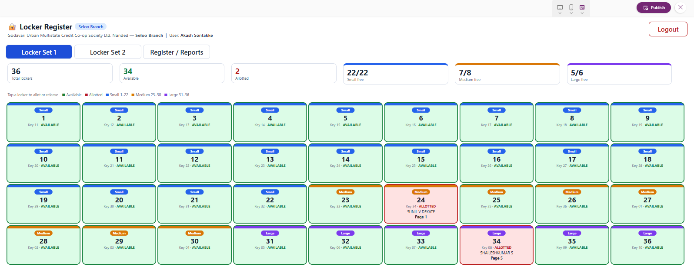
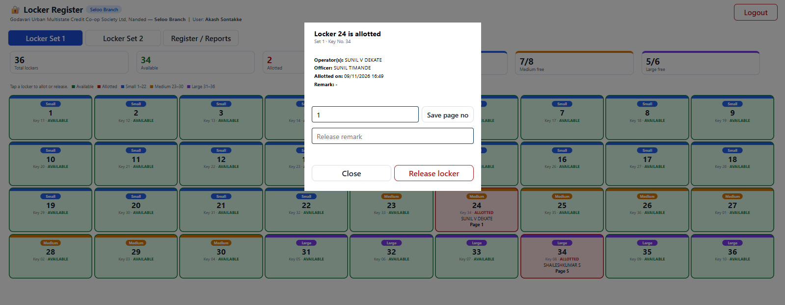
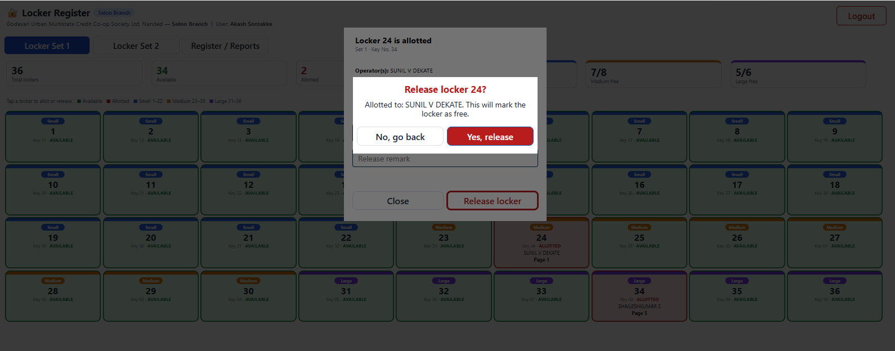
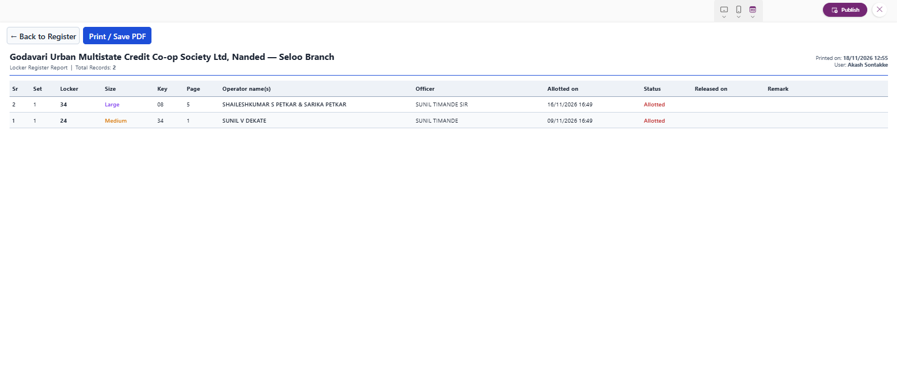
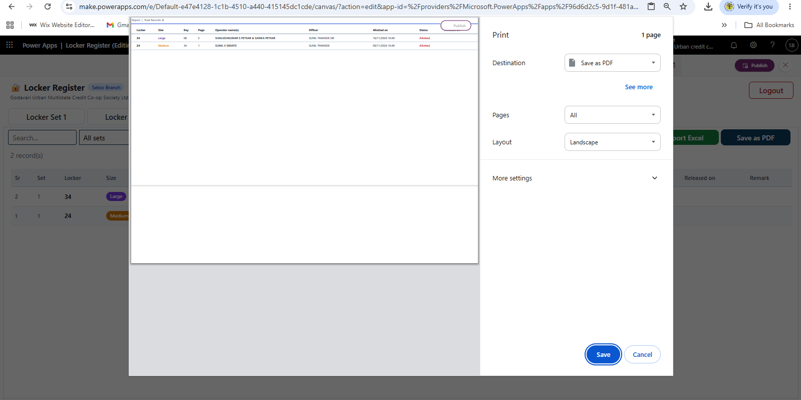

 🔐 Locker Register – Branch Locker Allotment Tracker

A Power Apps canvas app with SharePoint Online lists that tracks locker allotment and release at a co-operative credit society branch, replacing the physical register.

📌 Problem

Staff had to check a paper register every time a customer asked about a locker. This was slow, error-prone, and gave no history or search.

 ✅ Solution

- Visual grid of lockers in 2 sets (green = free, red = allotted)
- Allot a locker: operator name, officer, date/time, register page no., remarks
- Release a locker with an "Are you sure?" confirmation and release remark
- Searchable register with filters (set, size, status, date range)
- Print / Save as PDF report
- Login with lockout after 5 wrong attempts
- Responsive layout for mobile and desktop

🖼️ Screenshots

> All screenshots use test data only.

 Login

Locker grid

Allot a locker

Release a locker

Register and filters

Print report

 🧰 Tech stack

Power Apps (Canvas) · SharePoint Online · Power Fx · SVG-generated locker tiles

🗂️ Data model

LockerEntries

| Column | Purpose |
|---|---|
| Title | Operator name(s) |
| LockerSet, LockerNo | Which locker |
| KeyNo | Key number |
| PageNo | Physical register page reference |
| Officer | Officer who allotted |
| AllotAt | Allotment date and time |
| Remark | Allotment remark |
| ReleasedAt, RelRemark | Release date and remark |
| IsActive | true = currently allotted |

LockerUsers: user ID, full name, active flag, login credentials

 ▶️ How to run

1. Create the two SharePoint lists above.
2. In Power Apps, go to Apps → Import canvas app and upload `Locker_Register.msapp`.
3. Reconnect the data sources to your own lists.

 📈 Impact

Built and used at the  Branch,  Multistate Credit Co-op Society, Nanded. Staff now check locker availability in seconds instead of searching the paper register.

 🚀 Planned improvements

- Audit trail (allotted-by / released-by) saved with each entry
- Microsoft 365 sign-in instead of an in-app login
- Delegation-safe register filters for large history
- Gallery-based locker tiles to reduce app size

 👤 Author

Akash Ravi Sontakke
[GitHub](https://github.com/aakashsontakke456-pixel)
